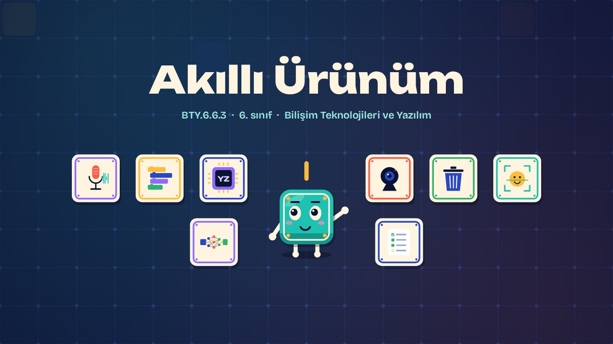
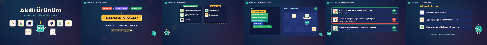

# Akıllı Ürünüm · My Smart Product

**▶ Tarayıcıda izleyin / Watch in the browser:** https://hakanatas.github.io/akilli-urunum/ 
**⬇ MP4 + altyazılar / MP4 + subtitles:** [Releases](https://github.com/hakanatas/akilli-urunum/releases) 
**✎ Kullanılan istem / The prompt behind it:** [PROMPT.md](PROMPT.md) 
**🎞 Bütün filmler / All films:** [Bilişim Filmleri](https://hakanatas.github.io/bilisim-filmleri/?sinif=6)

> **TR —** 6. sınıf Bilişim Teknolojileri ve Yazılım dersinin "Yazılım Tasarımı ve Programlama" temasındaki BTY.6.6.3 öğrenme çıktısı için hazırlanmış, tamamen JavaScript ile çizilen 2,4 dakikalık animasyon; ses efektleri ve hafif fon müziği de kodla üretilir. Blok tabanlı ortamda yapay zekâ destekli bir ürün geliştirilir: kameraya gösterilen atığı tanıyıp doğru kutuya yönlendiren "Akıllı Geri Dönüşüm Yardımcısı". Ürünün gereksinimleri (kamera girişi, sesli yönlendirme, kolay kullanım, gizlilik) belirlenir. Görüntü tanıma, ses tanıma ve metni sese çevirme gibi yapay zekâ eklentilerinden uygun araçlar seçilir. Ürün bloklarla oluşturulur, test edilir, hatası düzeltilir ve belirlenen ölçütleri karşılayacak şekilde çalışır hâle getirilir. Altyazılar Türkçe, İngilizce ya da ikisi birlikte seçilebilir.

A 2.4-minute animation, with code-generated sound, for **6th-grade IT and Software** (Türkiye Yüzyılı Maarif Modeli). A block-based AI product is built: a "Smart Recycling Helper" that recognises an item on camera and guides the user to the right bin. Requirements are set, AI extensions (image recognition, speech recognition, text-to-speech) are chosen, the product is built, tested, fixed and brought up to the agreed criteria. The guide is **Karo**, a living glazed tile who never speaks: he tells the story with his face, his arms and the blinking cursor above his head.

## Öğrenme çıktısı · Learning outcome

MEB, Türkiye Yüzyılı Maarif Modeli, Bilişim Teknolojileri ve Yazılım Dersi Öğretim Programı, 6. sınıf, 6. tema "Yazılım Tasarımı ve Programlama":

**BTY.6.6.3. Blok tabanlı ortamda yapay zekâ destekli ürün ortaya koyabilme**
- a) Blok tabanlı ortamda yapay zekâ destekli ürün için gereksinimleri belirler.
- b) Blok tabanlı ortamda yapay zekâ destekli ürün için kullanılacak araç gereçleri seçer.
- c) Blok tabanlı ortamda yapay zekâ destekli ürün oluşturur.
- ç) Blok tabanlı ortamda yapay zekâ destekli ürünü belirlenen ölçütleri karşılayacak şekilde çalışır hâle getirir.

## Sahneler · Scenes

| # | Zaman | Sahne | Ne oluyor | Çıktı |
|---|---|---|---|---|
| 1 | 0:00–0:17 | Giriş |  |  |
| 2 | 0:17–0:46 | Gereksinimler | Ürünün ihtiyaç duyduğu özellikler. | a |
| 3 | 0:46–1:08 | Araçları seç | Yapay zekâ eklentileri ve araç gereçler. | b |
| 4 | 1:08–1:47 | Oluştur ve çalıştır | Yapay zekâ blokları ile ürünü oluşturmak, test etmek ve düzeltmek. | c, ç |
| 5 | 1:47–2:09 | Ölçütleri karşılıyor mu? | Ürün belirlenen ölçütlere göre denetlenir. | ç |
| 6 | 2:09–2:25 | Aklında kalsın |  |  |

## Çalıştırma · Running it

- **Önizleme:** `index.html` dosyasına çift tıklayın (çevrim dışı da çalışır). Klavye: boşluk oynat/duraklat, ← → 3 sn, Home başa. Adrese `?altyazi=en`, `?bicim=vertical` ya da `?ses=0` eklenebilir.
- **MP4:** bir kez `npm install`, sonra `npm run export -- --format=both --captions=tr` (720p yatay ve dikey, sesli). Google Chrome yüklüyse Playwright onu kullanır (`channel: 'chrome'`); ffmpeg gerekir.
- **Altyazı ve seslendirme notları:** `npm run srt` → `out/akilli-urunum_tr.srt`, `_en.srt`, `_tr-en.srt`, `_seslendirme-notlari.txt`.
- **Sürüm dosyaları:** `npm run release` → `release/` klasöründe v1.0'ın 6 dosyası.
- **Yazı kontrolü:** `npm run check` yatay ve dikey düzende, üç altyazı seçeneğiyle üst üste binen, kenardan taşan ya da 720p'de 17 pikselden küçük kalan yazı arar.
- **Düzenleme:** senaryo (sahneler, altyazılar, seslendirme notları) `scenes/film.js` içindedir; değiştirince `npm run build` süreleri, `captions.js` ve `film.config.js` dosyalarını yeniden üretir. Sahne şablonları `src/kit/`, Karo `src/draw/karo.js`, ses `src/audio/synth.js`.

Her kare `renderFrame(t)` ile zamanın saf fonksiyonu olarak çizilir; rastgelelik tohumludur, MP4 ekran kaydı değil kare kare üretimdir. Ses de dosyadan çalınmaz: aynı olay listesinden hesaplanır. Yazı tipleri: Unbounded ve Bricolage Grotesque (SIL OFL 1.1), dosyaya gömülü.

## Lisans · License

**TR —** Bu film ve kodu [Creative Commons Atıf-GayriTicari 4.0 Uluslararası (CC BY-NC 4.0)](https://creativecommons.org/licenses/by-nc/4.0/deed.tr) lisansıyla paylaşılır. Ticari olmayan her amaçla (derste, okulda, eğitim materyalinde) kopyalayabilir, paylaşabilir ve değiştirebilirsiniz; ancak **kaynak göstermek zorunludur**: eser sahibinin adı ve bu deponun bağlantısı belirtilmeden kullanılamaz. Ticari kullanım (satış, ücretli ürün ya da yayın) için izin alınmalıdır.

**EN —** This film and its code are licensed under [Creative Commons Attribution-NonCommercial 4.0 International (CC BY-NC 4.0)](https://creativecommons.org/licenses/by-nc/4.0/). You may copy, share and adapt them for non-commercial purposes, but **attribution is required**: they may not be used without crediting the author and linking to this repository. Commercial use requires permission.

Atıf örneği / Required credit: *“Akıllı Ürünüm”, Hakan Ataş, Bilişim Filmleri — https://github.com/hakanatas/akilli-urunum — CC BY-NC 4.0*
